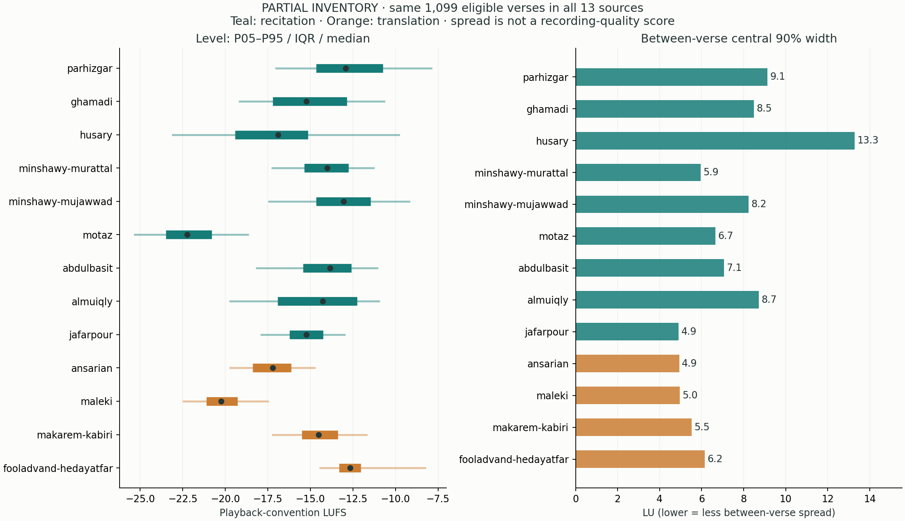
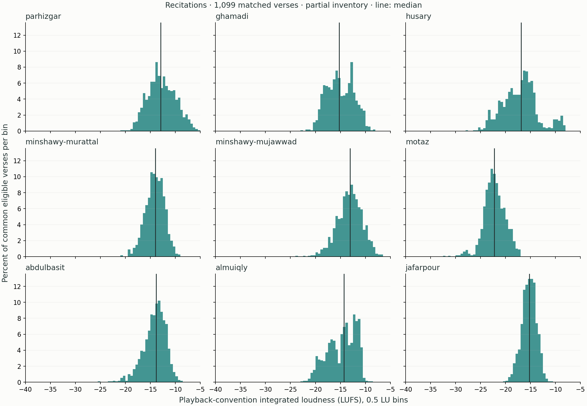
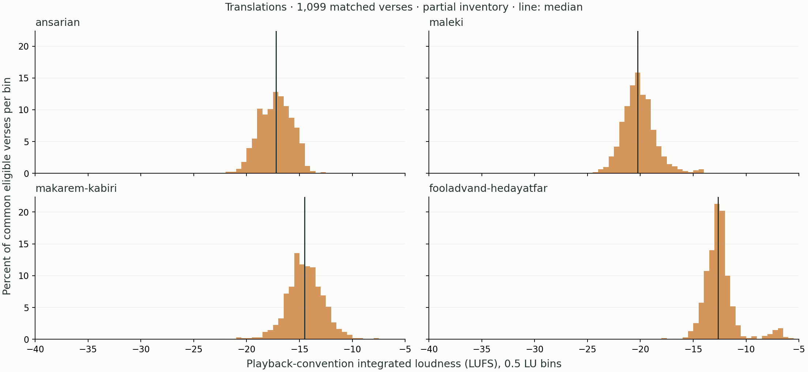
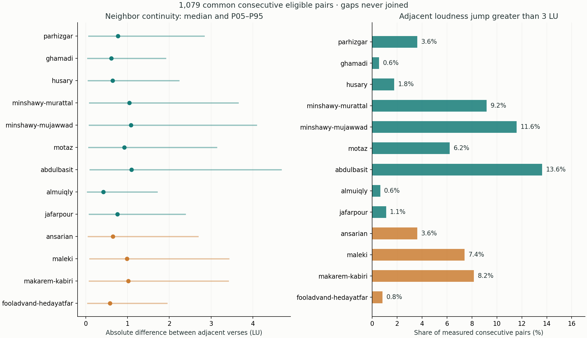
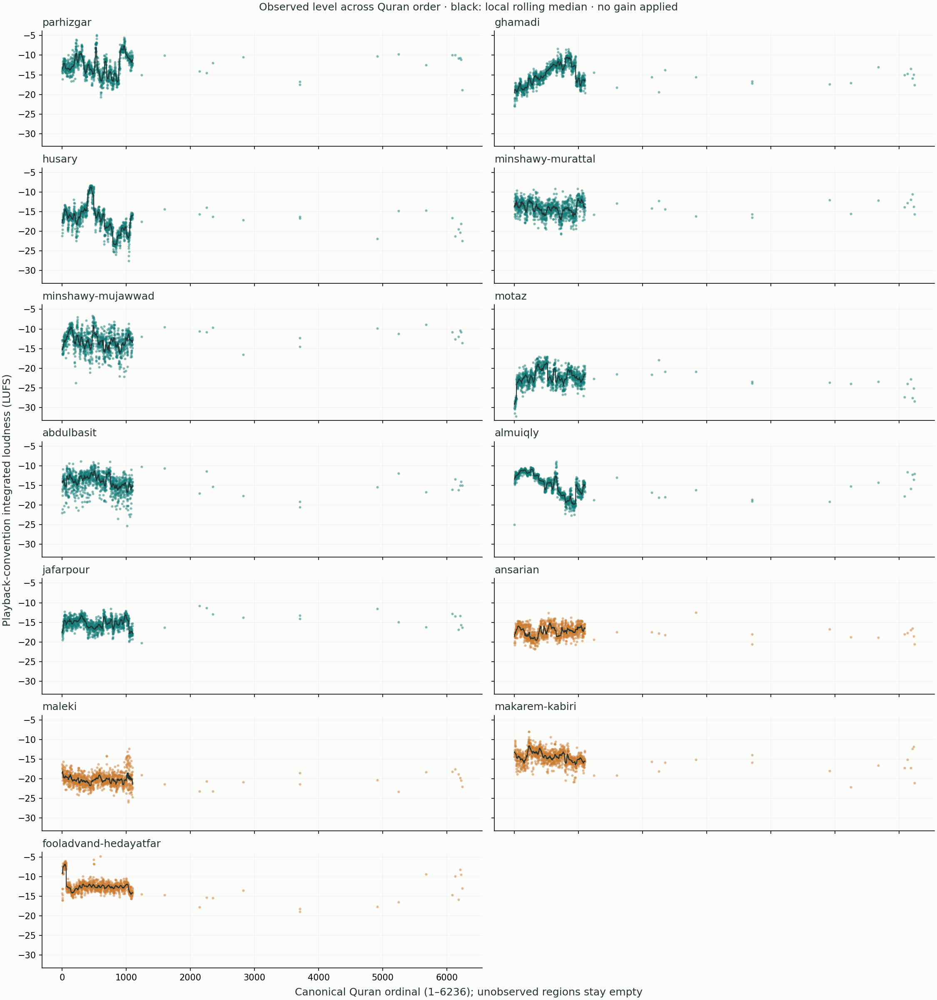

# پراکندگی و پیوستگی بلندی صوت

زمان snapshot به UTC: 2026-10-22T11:25:17.319138+00:00

14,497 فایل معتبر؛ 66,568 مورد بررسی‌نشده. مقایسهٔ منصفانه بر 1,099 آیهٔ مشترک بین هر ۱۳ منبع انجام شده است.

پوشش کامل هر مجموعه ۶٬۲۳۶ آیه است؛ بخش‌های بررسی‌نشده در نمودار ترتیب قرآن خالی مانده‌اند. مقایسهٔ این snapshot، نتیجه‌گیری دربارهٔ آیات دریافت‌نشده نیست.

## سه پرسش متفاوت

۱. سطح معمول صدا چقدر است؟ میانهٔ LUFS، مرکز بلندی هر مجموعه را نشان می‌دهد. پایین‌تر بودن این عدد یعنی صدای آرام‌تر، نه کیفیت پایین‌تر.
۲. بلندی بین آیات چقدر پخش است؟ فاصلهٔ P05 تا P95 نود درصد میانی آیات را می‌پوشاند؛ IQR و MAD در کنار آن گزارش شده‌اند. Gain ثابت این پهنا را کم نمی‌کند و تنها کل توزیع را جابه‌جا می‌کند.
۳. آیا آیات کنار هم جهش دارند؟ قدرمطلق اختلاف LUFS دو آیهٔ واقعاً متوالی، از پراکندگی سراسری متمایز است. هیچ فاصلهٔ بررسی‌نشده‌ای به هم وصل نشده است.

این‌ها با LRA درون یک فایل فرق دارند. قاری مجوّد می‌تواند تغییرات طبیعی بیشتری داشته باشد؛ پراکندگی بیشتر، اثبات خطای ضبط یا مجوز صاف‌کردن بیان نیست.

قرارداد پخش برای مقایسه: LUFS اصلی، با افزودن ۳٫۰۱۰۳ LU برای فایل مونو در فرض کپی دامنهٔ یکسان به دو کانال. اعداد LUFS اصلی native در measurements حفظ شده‌اند. آیات کوتاه‌تر از سه ثانیه یا با فعالیت کمتر از یک ثانیه از cohort مشترک کنار گذاشته می‌شوند.

| منبع | میانهٔ پخش LUFS | پهنای ۹۰٪ LU | MAD | میانهٔ جهش همسایه LU | جهش بیشتر از ۳ LU |
|---|---:|---:|---:|---:|---:|
| پرهیزگار | -12.93 | 9.13 | 1.97 | 0.78 | 3.6٪ |
| غامدی | -15.23 | 8.48 | 2.20 | 0.61 | 0.6٪ |
| حصری | -16.90 | 13.28 | 2.14 | 0.65 | 1.8٪ |
| منشاوی ترتیل | -14.01 | 5.95 | 1.30 | 1.05 | 9.2٪ |
| منشاوی مجوّد | -13.05 | 8.23 | 1.61 | 1.09 | 11.6٪ |
| معتز آقایی | -22.24 | 6.66 | 1.34 | 0.93 | 6.2٪ |
| عبدالباسط | -13.84 | 7.06 | 1.38 | 1.10 | 13.6٪ |
| معیقلی | -14.28 | 8.72 | 2.26 | 0.42 | 0.6٪ |
| جعفرپور | -15.24 | 4.91 | 0.98 | 0.76 | 1.1٪ |
| انصاریان | -17.20 | 4.94 | 1.14 | 0.65 | 3.6٪ |
| ملکی | -20.24 | 4.96 | 0.94 | 0.98 | 7.4٪ |
| مکارم شیرازی | -14.50 | 5.51 | 1.05 | 1.02 | 8.2٪ |
| فولادوند | -12.65 | 6.15 | 0.62 | 0.58 | 0.8٪ |

## برداشت عملی از همین نمونه

در آیات مشترک فعلی، کمترین پهنای ۹۰٪ میان تلاوت‌ها برای جعفرپور (4.91 LU) و میان ترجمه‌ها برای انصاریان (4.94 LU) دیده می‌شود. این رتبه‌بندیِ پراکندگی است، نه رتبه‌بندی کیفیت یا مطلوبیت اجرا.

برای طراحی Gain ابتدا اختلاف مرکز مجموعه‌ها را جبران کنید. اگر پهنای یک مجموعه زیاد است، به جای برابرکردن تک‌تک آیات، نمودار روند و فرضیه‌های تغییر پایدار ضبط را بازبینی کنید. جهش‌های منفرد، سکوت زیاد یا خطای Decode باید جدا بررسی شوند.

نسخهٔ عددی همهٔ آمارها در distribution-summary.json و CSV است. درصد جهش‌های بیش از ۳ LU یک آستانهٔ توصیفی است، نه تشخیص قطعی آزاردهندگی. قضاوت ادراکی نهایی به گوش‌دادن روی دستگاه و محتوای همان آیات نیاز دارد.
