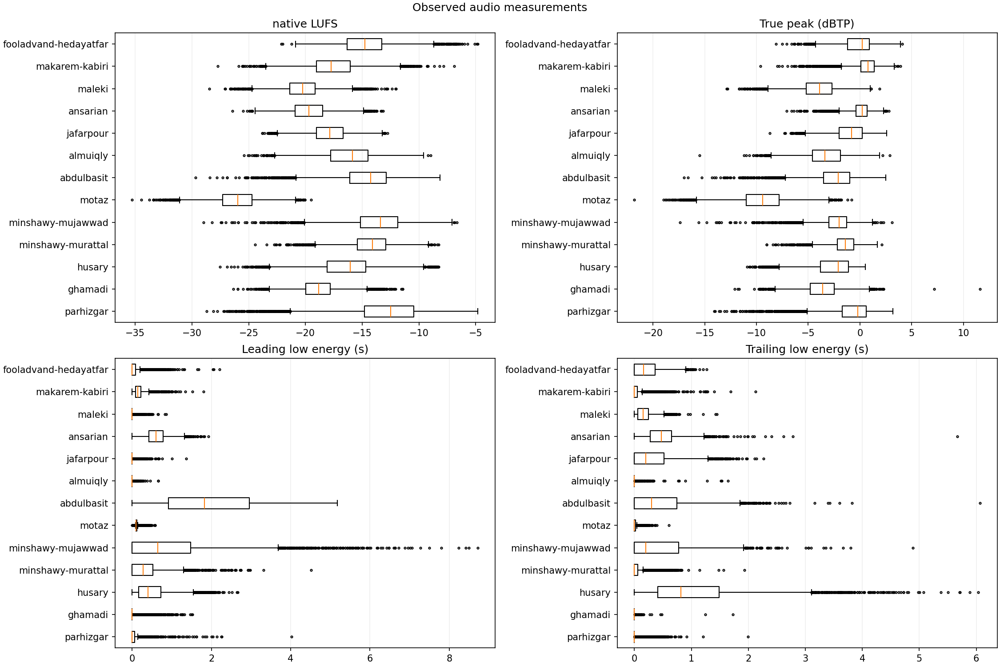
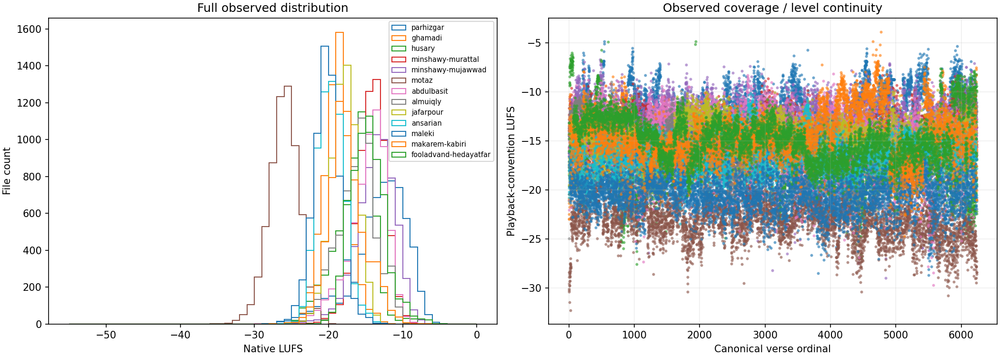
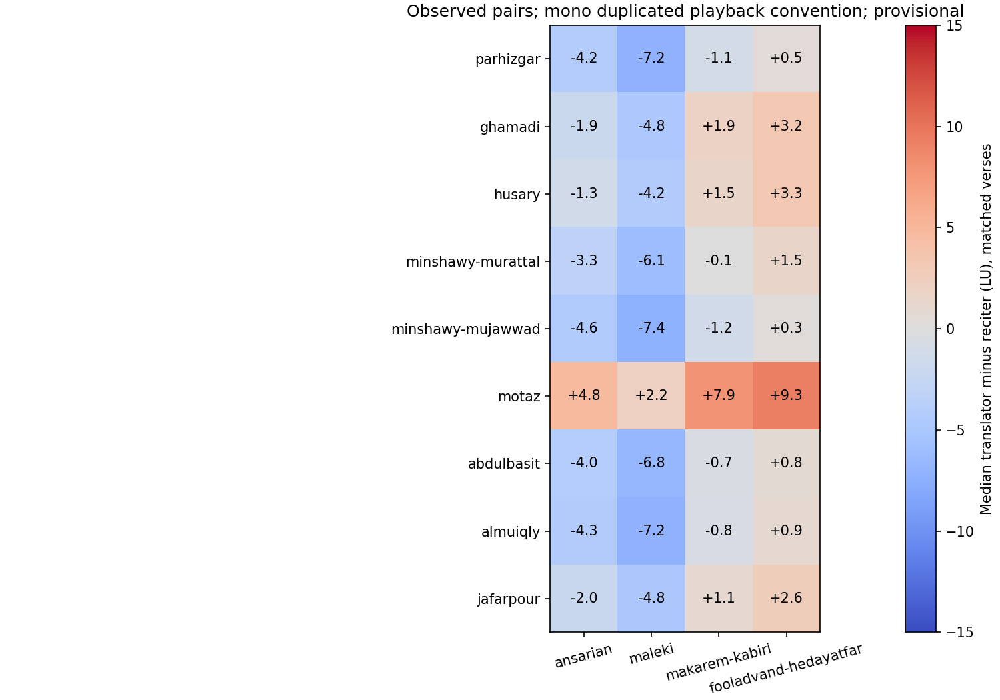

# گزارش استخراج و تحلیل صوت قرآن

زمان snapshot به UTC: 2026-10-23T02:16:37.882249+00:00

**وضعیت: فهرست همهٔ منابع بررسی شده است. 81,068 فایل با موفقیت اندازه‌گیری شده و 0 مورد هنوز بررسی نشده است.**

نبودن رکورد به معنای ناموجودبودن فایل نیست. 404/410 از خطای شبکه و خطای Decode جدا است. همهٔ شناسه‌های مورد انتظار بررسی شده‌اند؛ معتبر بودن انتساب و محتوای خوانده‌شده نیازمند بازبینی مستقل است.

## تفکیک اعتبار نتایج

- Measured: خروجی واقعی FFmpeg از بایت‌های مرجع دریافت‌شده یا جایگزین پذیرفته‌شده؛ شامل هش، شرایط اندازه‌گیری و محدودیت دقت. این امر صحت محتوای تلاوت یا انتساب قاری را ثابت نمی‌کند.
- Inferred: baseline، تخمین فعالیت صوت، فرضیهٔ تغییر ضبط و ناهنجاری‌ها. انرژی پایین لزوماً سکوت شنیداری نیست و امتیاز اطمینان، احتمال کالیبره‌شده نیست.
- Recommended: سناریوی Gain وابسته به سیاست؛ اصلاح‌های استنباطی تا ثبت تأیید انسانی اعمال نمی‌شوند. محاسبهٔ Gain هیچ فایل صوتی را نرمال‌سازی یا Encode نمی‌کند.

## پوشش واقعی

| منبع | موفق | ناموجود | نامعتبر | موقت | HTTP دیگر | بررسی‌نشده |
|---|---:|---:|---:|---:|---:|---:|
| parhizgar | 6236 | 0 | 0 | 0 | 0 | 0 |
| ghamadi | 6236 | 0 | 0 | 0 | 0 | 0 |
| husary | 6236 | 0 | 0 | 0 | 0 | 0 |
| minshawy-murattal | 6236 | 0 | 0 | 0 | 0 | 0 |
| minshawy-mujawwad | 6236 | 0 | 0 | 0 | 0 | 0 |
| motaz | 6236 | 0 | 0 | 0 | 0 | 0 |
| abdulbasit | 6236 | 0 | 0 | 0 | 0 | 0 |
| almuiqly | 6236 | 0 | 0 | 0 | 0 | 0 |
| jafarpour | 6236 | 0 | 0 | 0 | 0 | 0 |
| ansarian | 6236 | 0 | 0 | 0 | 0 | 0 |
| maleki | 6236 | 0 | 0 | 0 | 0 | 0 |
| makarem-kabiri | 6236 | 0 | 0 | 0 | 0 | 0 |
| fooladvand-hedayatfar | 6236 | 0 | 0 | 0 | 0 | 0 |

## نسخه‌های جایگزین تأییدشده برای استفاده

11 فایل جایگزین با پذیرش کاربر مبنای اندازه‌گیری است؛ 11 مورد هنوز در URL اصلی تأیید انتشار نشده‌اند. موفق بودن اندازه‌گیری محلی به معنی سالم بودن بایت‌های فعلی CDN نیست. ریشه و هش هر جایگزین و سوابق فایل قدیمی در replacement-publication.json و replacement-history ثبت شده است. پذیرش کاربر معادل تأیید مستقل شنیداری نیست.

## نوع واقعی دادهٔ صوتی

پسوند URL مبنای تشخیص Codec نبوده است. فایل غیر MP3 که با پسوند mp3 ارائه شده باشد، در صورت Decode معتبر در اندازه‌گیری‌ها باقی می‌ماند و برای سازگاری Container/MIME پلیر پرچم می‌گیرد؛ هیچ تبدیل فرمت انجام نشده است.

| منبع | تعداد به تفکیک Codec واقعی | ناسازگار با پسوند MP3 |
|---|---|---:|
| parhizgar | mp3: 6236 | 0 |
| ghamadi | mp3: 6236 | 0 |
| husary | mp3: 6236 | 0 |
| minshawy-murattal | mp3: 6236 | 0 |
| minshawy-mujawwad | mp3: 6236 | 0 |
| motaz | mp3: 6236 | 0 |
| abdulbasit | mp3: 6236 | 0 |
| almuiqly | mp3: 6124, pcm_s16le: 112 | 112 |
| jafarpour | mp3: 6236 | 0 |
| ansarian | mp3: 6236 | 0 |
| maleki | mp3: 6236 | 0 |
| makarem-kabiri | mp3: 6236 | 0 |
| fooladvand-hedayatfar | mp3: 6236 | 0 |

## توزیع‌ها و مقایسهٔ سطح بلندی

برای مقایسهٔ منصفانهٔ منابع، نمودارهای زیر فقط آیات مشترکِ معتبر هر ۱۳ منبع با مدت حداقل سه ثانیه و فعالیت حداقل یک ثانیه را نشان می‌دهند. اعداد هر نمودار تعداد واقعی cohort را مشخص می‌کند. این نمودارها از پهنای کلی توزیع، جهش همسایه‌ها و سطح معمول صدا تفکیک می‌سازند.

هر آیه یک مشاهده است. baseline، میانهٔ وزنی با وزن مدت فعالیتِ محدودشده به ۲۰ ثانیه است؛ LUFS آلبوم یا اندازه‌گیری یک اجرای پیوسته محسوب نمی‌شود. فایل‌های کوتاه و دارای فعالیت زیر یک ثانیه از baseline کنار گذاشته می‌شوند.

LUFS اصلی با کانال‌های واقعی فایل و dualmono=false ثبت شده است. برای مقایسهٔ پخش متعارف، به فایل مونو ۳٫۰۱۰۳ LU افزوده می‌شود؛ این فقط برای پخشی معتبر است که مونو را با همان دامنه به هر دو کانال کپی کند. در صورت pan-law متفاوت باید این فرض تغییر کند.

| منبع | میانه LUFS اصلی | baseline پخش | MAD پخش | p95 True Peak |
|---|---:|---:|---:|---:|
| parhizgar | -12.49 | -12.47 | 2.15 | 1.60 |
| ghamadi | -18.82 | -15.79 | 1.08 | -0.60 |
| husary | -16.04 | -16.02 | 1.62 | -0.30 |
| minshawy-murattal | -14.10 | -14.14 | 1.24 | 0.10 |
| minshawy-mujawwad | -13.41 | -13.34 | 1.64 | -0.40 |
| motaz | -25.97 | -22.66 | 1.28 | -5.50 |
| abdulbasit | -14.24 | -14.15 | 1.53 | 0.10 |
| almuiqly | -15.87 | -15.82 | 1.54 | 0.00 |
| jafarpour | -17.84 | -14.80 | 1.17 | 1.50 |
| ansarian | -19.71 | -16.71 | 1.22 | 1.40 |
| maleki | -20.24 | -20.11 | 1.11 | -0.90 |
| makarem-kabiri | -17.73 | -14.86 | 1.43 | 2.20 |
| fooladvand-hedayatfar | -14.78 | -14.53 | 1.52 | 2.20 |

## فرضیه‌های تغییر شرایط ضبط

آزمون پنجره‌های دوطرفهٔ ۲۰ آیه‌ای، بررسی پایداری در نیم‌پنجره‌ها، حذف قله‌های نزدیک و شواهد طیف/نویز به کار رفته است. تحلیل از روی شکاف‌های بررسی‌نشده نمی‌پرد. مرز سوره و جزء فقط شاهد کمکی است. حذف یک پنجره به علت کمبود داده به معنای نبود تغییر نیست.

هماهنگی proxy نویز با LUFS شاهد مستقلی نیست، چون هر دو از همان دامنهٔ صوت مشتق می‌شوند؛ centroid طیفی نیز به واج‌های خوانده‌شده حساس است. حتی چند شاهد هم‌سو، جلسهٔ تاریخی ضبط یا خطای میکس را ثابت نمی‌کند.

حساسیت تغییر پایدار نیز قابل تنظیم است: ضریب حداقل جهش برای ترتیل ۱، مجوّد ۱٫۵ و ترجمه ۰٫۸۵ است؛ نسبت به حد پایهٔ ۳ LU. مجوّد محافظه‌کارانه‌تر و ترجمه حساس‌تر بررسی می‌شود.

- parhizgar، حوالی 2:200: تغییر +3.10 LU، امتیاز اطمینان 0.77؛ نیازمند بازبینی.
- parhizgar، حوالی 2:223: تغییر -3.76 LU، امتیاز اطمینان 0.82؛ نیازمند بازبینی.
- parhizgar، حوالی 3:44: تغییر -3.21 LU، امتیاز اطمینان 0.82؛ نیازمند بازبینی.
- parhizgar، حوالی 4:24: تغییر +5.69 LU، امتیاز اطمینان 0.88؛ نیازمند بازبینی.
- parhizgar، حوالی 4:47: تغییر -6.29 LU، امتیاز اطمینان 0.88؛ نیازمند بازبینی.
- parhizgar، حوالی 5:24: تغییر -4.90 LU، امتیاز اطمینان 0.73؛ نیازمند بازبینی.
- parhizgar، حوالی 6:89: تغییر +3.42 LU، امتیاز اطمینان 0.69؛ نیازمند بازبینی.
- parhizgar، حوالی 6:110: تغییر +4.17 LU، امتیاز اطمینان 0.88؛ نیازمند بازبینی.
- parhizgar، حوالی 8:42: تغییر -4.65 LU، امتیاز اطمینان 0.88؛ نیازمند بازبینی.
- parhizgar، حوالی 9:39: تغییر +4.52 LU، امتیاز اطمینان 0.88؛ نیازمند بازبینی.
- parhizgar، حوالی 10:35: تغییر -3.78 LU، امتیاز اطمینان 0.71؛ نیازمند بازبینی.
- parhizgar، حوالی 11:6: تغییر -5.23 LU، امتیاز اطمینان 0.88؛ نیازمند بازبینی.
- parhizgar، حوالی 17:2: تغییر +4.59 LU، امتیاز اطمینان 0.88؛ نیازمند بازبینی.
- parhizgar، حوالی 17:99: تغییر -3.45 LU، امتیاز اطمینان 0.84؛ نیازمند بازبینی.
- parhizgar، حوالی 20:1: تغییر +5.27 LU، امتیاز اطمینان 0.79؛ نیازمند بازبینی.
- parhizgar، حوالی 20:44: تغییر +3.26 LU، امتیاز اطمینان 0.75؛ نیازمند بازبینی.
- parhizgar، حوالی 23:44: تغییر -4.19 LU، امتیاز اطمینان 0.88؛ نیازمند بازبینی.
- parhizgar، حوالی 24:28: تغییر +4.15 LU، امتیاز اطمینان 0.69؛ نیازمند بازبینی.
- parhizgar، حوالی 26:77: تغییر -3.71 LU، امتیاز اطمینان 0.63؛ نیازمند بازبینی.
- parhizgar، حوالی 29:52: تغییر +3.53 LU، امتیاز اطمینان 0.84؛ نیازمند بازبینی.
- parhizgar، حوالی 33:72: تغییر -3.54 LU، امتیاز اطمینان 0.85؛ نیازمند بازبینی.
- parhizgar، حوالی 35:1: تغییر -7.88 LU، امتیاز اطمینان 0.88؛ نیازمند بازبینی.
- parhizgar، حوالی 36:21: تغییر +4.70 LU، امتیاز اطمینان 0.78؛ نیازمند بازبینی.
- parhizgar، حوالی 36:83: تغییر -6.85 LU، امتیاز اطمینان 0.88؛ نیازمند بازبینی.
- parhizgar، حوالی 39:31: تغییر +3.13 LU، امتیاز اطمینان 0.77؛ نیازمند بازبینی.
- parhizgar، حوالی 41:49: تغییر +4.94 LU، امتیاز اطمینان 0.87؛ نیازمند بازبینی.
- parhizgar، حوالی 48:23: تغییر -4.88 LU، امتیاز اطمینان 0.88؛ نیازمند بازبینی.
- parhizgar، حوالی 55:77: تغییر -3.34 LU، امتیاز اطمینان 0.78؛ نیازمند بازبینی.
- parhizgar، حوالی 57:27: تغییر +4.07 LU، امتیاز اطمینان 0.88؛ نیازمند بازبینی.
- parhizgar، حوالی 67:3: تغییر -3.87 LU، امتیاز اطمینان 0.87؛ نیازمند بازبینی.
- parhizgar، حوالی 74:1: تغییر -14.53 LU، امتیاز اطمینان 0.88؛ نیازمند بازبینی.
- parhizgar، حوالی 78:6: تغییر +8.65 LU، امتیاز اطمینان 0.88؛ نیازمند بازبینی.
- parhizgar، حوالی 81:20: تغییر +3.52 LU، امتیاز اطمینان 0.74؛ نیازمند بازبینی.
- ghamadi، حوالی 7:6: تغییر -4.73 LU، امتیاز اطمینان 0.88؛ نیازمند بازبینی.
- ghamadi، حوالی 8:2: تغییر +3.65 LU، امتیاز اطمینان 0.86؛ نیازمند بازبینی.
- ghamadi، حوالی 10:8: تغییر -3.88 LU، امتیاز اطمینان 0.87؛ نیازمند بازبینی.
- ghamadi، حوالی 11:4: تغییر +3.76 LU، امتیاز اطمینان 0.86؛ نیازمند بازبینی.
- ghamadi، حوالی 30:1: تغییر -3.65 LU، امتیاز اطمینان 0.86؛ نیازمند بازبینی.
- ghamadi، حوالی 37:6: تغییر -3.56 LU، امتیاز اطمینان 0.85؛ نیازمند بازبینی.
- ghamadi، حوالی 38:12: تغییر +3.07 LU، امتیاز اطمینان 0.81؛ نیازمند بازبینی.
- husary، حوالی 2:206: تغییر -3.08 LU، امتیاز اطمینان 0.74؛ نیازمند بازبینی.
- husary، حوالی 3:103: تغییر +4.37 LU، امتیاز اطمینان 0.88؛ نیازمند بازبینی.
- husary، حوالی 4:4: تغییر -4.85 LU، امتیاز اطمینان 0.88؛ نیازمند بازبینی.
- husary، حوالی 4:164: تغییر -3.69 LU، امتیاز اطمینان 0.86؛ نیازمند بازبینی.
- husary، حوالی 6:1: تغییر -4.09 LU، امتیاز اطمینان 0.88؛ نیازمند بازبینی.
- husary، حوالی 7:108: تغییر +3.85 LU، امتیاز اطمینان 0.70؛ نیازمند بازبینی.
- husary، حوالی 9:125: تغییر +4.46 LU، امتیاز اطمینان 0.88؛ نیازمند بازبینی.
- husary، حوالی 15:7: تغییر -3.87 LU، امتیاز اطمینان 0.87؛ نیازمند بازبینی.
- husary، حوالی 21:24: تغییر -3.28 LU، امتیاز اطمینان 0.79؛ نیازمند بازبینی.
- husary، حوالی 27:54: تغییر -5.97 LU، امتیاز اطمینان 0.88؛ نیازمند بازبینی.
- husary، حوالی 31:1: تغییر +4.33 LU، امتیاز اطمینان 0.73؛ نیازمند بازبینی.
- husary، حوالی 35:28: تغییر -3.20 LU، امتیاز اطمینان 0.82؛ نیازمند بازبینی.
- husary، حوالی 43:67: تغییر -4.47 LU، امتیاز اطمینان 0.88؛ نیازمند بازبینی.
- husary، حوالی 54:53: تغییر -4.05 LU، امتیاز اطمینان 0.88؛ نیازمند بازبینی.
- husary، حوالی 55:23: تغییر +5.02 LU، امتیاز اطمینان 0.88؛ نیازمند بازبینی.
- husary، حوالی 78:6: تغییر +3.53 LU، امتیاز اطمینان 0.82؛ نیازمند بازبینی.
- husary، حوالی 80:18: تغییر -5.42 LU، امتیاز اطمینان 0.82؛ نیازمند بازبینی.
- husary، حوالی 82:2: تغییر -5.23 LU، امتیاز اطمینان 0.88؛ نیازمند بازبینی.
- minshawy-murattal، حوالی 5:76: تغییر +3.26 LU، امتیاز اطمینان 0.77؛ نیازمند بازبینی.
- minshawy-murattal، حوالی 12:20: تغییر -3.58 LU، امتیاز اطمینان 0.78؛ نیازمند بازبینی.
- minshawy-murattal، حوالی 12:49: تغییر +3.87 LU، امتیاز اطمینان 0.80؛ نیازمند بازبینی.
- minshawy-murattal، حوالی 19:62: تغییر -3.07 LU، امتیاز اطمینان 0.81؛ نیازمند بازبینی.
- minshawy-murattal، حوالی 23:28: تغییر -3.12 LU، امتیاز اطمینان 0.62؛ نیازمند بازبینی.
- minshawy-murattal، حوالی 23:54: تغییر +3.86 LU، امتیاز اطمینان 0.80؛ نیازمند بازبینی.
- minshawy-murattal، حوالی 23:75: تغییر -3.63 LU، امتیاز اطمینان 0.77؛ نیازمند بازبینی.
- minshawy-murattal، حوالی 23:101: تغییر +3.50 LU، امتیاز اطمینان 0.81؛ نیازمند بازبینی.
- minshawy-murattal، حوالی 26:2: تغییر +3.28 LU، امتیاز اطمینان 0.83؛ نیازمند بازبینی.
- minshawy-murattal، حوالی 52:4: تغییر +3.61 LU، امتیاز اطمینان 0.75؛ نیازمند بازبینی.
- minshawy-murattal، حوالی 66:3: تغییر +3.18 LU، امتیاز اطمینان 0.61؛ نیازمند بازبینی.
- minshawy-mujawwad، حوالی 3:187: تغییر +5.55 LU، امتیاز اطمینان 0.78؛ نیازمند بازبینی.
- minshawy-mujawwad، حوالی 9:111: تغییر -4.68 LU، امتیاز اطمینان 0.88؛ نیازمند بازبینی.
- minshawy-mujawwad، حوالی 10:2: تغییر +5.08 LU، امتیاز اطمینان 0.81؛ نیازمند بازبینی.
- minshawy-mujawwad، حوالی 18:64: تغییر -4.78 LU، امتیاز اطمینان 0.82؛ نیازمند بازبینی.
- minshawy-mujawwad، حوالی 23:115: تغییر -6.47 LU، امتیاز اطمینان 0.67؛ نیازمند بازبینی.
- minshawy-mujawwad، حوالی 24:22: تغییر +5.01 LU، امتیاز اطمینان 0.77؛ نیازمند بازبینی.
- minshawy-mujawwad، حوالی 24:58: تغییر -5.56 LU، امتیاز اطمینان 0.70؛ نیازمند بازبینی.
- minshawy-mujawwad، حوالی 28:11: تغییر -4.97 LU، امتیاز اطمینان 0.77؛ نیازمند بازبینی.
- minshawy-mujawwad، حوالی 28:31: تغییر +4.64 LU، امتیاز اطمینان 0.84؛ نیازمند بازبینی.
- minshawy-mujawwad، حوالی 30:36: تغییر -7.26 LU، امتیاز اطمینان 0.67؛ نیازمند بازبینی.
- minshawy-mujawwad، حوالی 30:57: تغییر +7.59 LU، امتیاز اطمینان 0.81؛ نیازمند بازبینی.
- minshawy-mujawwad، حوالی 33:10: تغییر -4.87 LU، امتیاز اطمینان 0.73؛ نیازمند بازبینی.
- minshawy-mujawwad، حوالی 33:55: تغییر +7.72 LU، امتیاز اطمینان 0.73؛ نیازمند بازبینی.
- minshawy-mujawwad، حوالی 37:152: تغییر +4.54 LU، امتیاز اطمینان 0.76؛ نیازمند بازبینی.
- minshawy-mujawwad، حوالی 51:11: تغییر +4.81 LU، امتیاز اطمینان 0.76؛ نیازمند بازبینی.
- minshawy-mujawwad، حوالی 64:16: تغییر -4.78 LU، امتیاز اطمینان 0.71؛ نیازمند بازبینی.
- minshawy-mujawwad، حوالی 68:2: تغییر +7.14 LU، امتیاز اطمینان 0.87؛ نیازمند بازبینی.
- minshawy-mujawwad، حوالی 69:47: تغییر -5.25 LU، امتیاز اطمینان 0.88؛ نیازمند بازبینی.
- minshawy-mujawwad، حوالی 77:49: تغییر +5.01 LU، امتیاز اطمینان 0.75؛ نیازمند بازبینی.
- motaz، حوالی 2:19: تغییر +4.30 LU، امتیاز اطمینان 0.88؛ نیازمند بازبینی.
- motaz، حوالی 4:23: تغییر -4.89 LU، امتیاز اطمینان 0.88؛ نیازمند بازبینی.
- motaz، حوالی 4:114: تغییر +3.40 LU، امتیاز اطمینان 0.84؛ نیازمند بازبینی.
- motaz، حوالی 4:148: تغییر -4.15 LU، امتیاز اطمینان 0.88؛ نیازمند بازبینی.
- motaz، حوالی 8:41: تغییر -3.26 LU، امتیاز اطمینان 0.63؛ نیازمند بازبینی.
- motaz، حوالی 20:135: تغییر -3.72 LU، امتیاز اطمینان 0.82؛ نیازمند بازبینی.
- motaz، حوالی 39:30: تغییر -3.45 LU، امتیاز اطمینان 0.84؛ نیازمند بازبینی.
- motaz، حوالی 67:2: تغییر -3.69 LU، امتیاز اطمینان 0.85؛ نیازمند بازبینی.
- motaz، حوالی 80:18: تغییر -3.00 LU، امتیاز اطمینان 0.62؛ نیازمند بازبینی.
- abdulbasit، حوالی 2:59: تغییر +3.16 LU، امتیاز اطمینان 0.76؛ نیازمند بازبینی.
- abdulbasit، حوالی 5:82: تغییر -3.48 LU، امتیاز اطمینان 0.69؛ نیازمند بازبینی.
- abdulbasit، حوالی 15:77: تغییر +3.10 LU، امتیاز اطمینان 0.63؛ نیازمند بازبینی.
- abdulbasit، حوالی 21:100: تغییر -5.73 LU، امتیاز اطمینان 0.76؛ نیازمند بازبینی.
- abdulbasit، حوالی 23:48: تغییر +4.79 LU، امتیاز اطمینان 0.74؛ نیازمند بازبینی.
- abdulbasit، حوالی 23:74: تغییر -3.69 LU، امتیاز اطمینان 0.76؛ نیازمند بازبینی.
- abdulbasit، حوالی 26:14: تغییر -5.25 LU، امتیاز اطمینان 0.80؛ نیازمند بازبینی.
- abdulbasit، حوالی 26:34: تغییر +5.29 LU، امتیاز اطمینان 0.79؛ نیازمند بازبینی.
- abdulbasit، حوالی 26:223: تغییر -6.52 LU، امتیاز اطمینان 0.79؛ نیازمند بازبینی.
- abdulbasit، حوالی 37:20: تغییر +4.33 LU، امتیاز اطمینان 0.63؛ نیازمند بازبینی.
- abdulbasit، حوالی 37:54: تغییر -4.15 LU، امتیاز اطمینان 0.77؛ نیازمند بازبینی.
- abdulbasit، حوالی 37:77: تغییر +3.65 LU، امتیاز اطمینان 0.79؛ نیازمند بازبینی.
- abdulbasit، حوالی 38:24: تغییر +3.30 LU، امتیاز اطمینان 0.74؛ نیازمند بازبینی.
- abdulbasit، حوالی 40:34: تغییر +3.90 LU، امتیاز اطمینان 0.63؛ نیازمند بازبینی.
- abdulbasit، حوالی 50:23: تغییر -3.78 LU، امتیاز اطمینان 0.79؛ نیازمند بازبینی.
- abdulbasit، حوالی 56:24: تغییر +3.87 LU، امتیاز اطمینان 0.84؛ نیازمند بازبینی.
- abdulbasit، حوالی 56:88: تغییر -3.84 LU، امتیاز اطمینان 0.75؛ نیازمند بازبینی.
- abdulbasit، حوالی 68:33: تغییر -5.71 LU، امتیاز اطمینان 0.83؛ نیازمند بازبینی.
- abdulbasit، حوالی 69:1: تغییر +4.23 LU، امتیاز اطمینان 0.76؛ نیازمند بازبینی.
- abdulbasit، حوالی 72:1: تغییر -3.42 LU، امتیاز اطمینان 0.84؛ نیازمند بازبینی.
- abdulbasit، حوالی 73:19: تغییر -3.35 LU، امتیاز اطمینان 0.80؛ نیازمند بازبینی.
- abdulbasit، حوالی 77:34: تغییر -3.37 LU، امتیاز اطمینان 0.78؛ نیازمند بازبینی.
- almuiqly، حوالی 4:170: تغییر -3.11 LU، امتیاز اطمینان 0.75؛ نیازمند بازبینی.
- almuiqly، حوالی 6:165: تغییر +5.09 LU، امتیاز اطمینان 0.88؛ نیازمند بازبینی.
- almuiqly، حوالی 7:204: تغییر -3.03 LU، امتیاز اطمینان 0.78؛ نیازمند بازبینی.
- almuiqly، حوالی 11:5: تغییر +5.10 LU، امتیاز اطمینان 0.88؛ نیازمند بازبینی.
- almuiqly، حوالی 15:1: تغییر -4.04 LU، امتیاز اطمینان 0.88؛ نیازمند بازبینی.
- almuiqly، حوالی 33:71: تغییر -6.10 LU، امتیاز اطمینان 0.88؛ نیازمند بازبینی.
- almuiqly، حوالی 42:14: تغییر +3.29 LU، امتیاز اطمینان 0.83؛ نیازمند بازبینی.
- almuiqly، حوالی 45:1: تغییر +3.02 LU، امتیاز اطمینان 0.81؛ نیازمند بازبینی.
- jafarpour، حوالی 4:148: تغییر +3.45 LU، امتیاز اطمینان 0.84؛ نیازمند بازبینی.
- jafarpour، حوالی 5:109: تغییر -3.13 LU، امتیاز اطمینان 0.77؛ نیازمند بازبینی.
- jafarpour، حوالی 7:88: تغییر -3.71 LU، امتیاز اطمینان 0.86؛ نیازمند بازبینی.
- jafarpour، حوالی 12:14: تغییر +3.73 LU، امتیاز اطمینان 0.71؛ نیازمند بازبینی.
- ansarian، حوالی 2:244: تغییر -2.73 LU، امتیاز اطمینان 0.76؛ نیازمند بازبینی.
- ansarian، حوالی 3:165: تغییر +2.63 LU، امتیاز اطمینان 0.78؛ نیازمند بازبینی.
- ansarian، حوالی 12:52: تغییر -3.33 LU، امتیاز اطمینان 0.83؛ نیازمند بازبینی.
- ansarian، حوالی 14:31: تغییر -2.73 LU، امتیاز اطمینان 0.79؛ نیازمند بازبینی.
- ansarian، حوالی 14:51: تغییر +4.63 LU، امتیاز اطمینان 0.88؛ نیازمند بازبینی.
- ansarian، حوالی 17:3: تغییر +2.56 LU، امتیاز اطمینان 0.77؛ نیازمند بازبینی.
- ansarian، حوالی 19:64: تغییر +3.33 LU، امتیاز اطمینان 0.83؛ نیازمند بازبینی.
- ansarian، حوالی 20:4: تغییر -2.66 LU، امتیاز اطمینان 0.77؛ نیازمند بازبینی.
- ansarian، حوالی 20:95: تغییر +3.27 LU، امتیاز اطمینان 0.76؛ نیازمند بازبینی.
- ansarian، حوالی 20:115: تغییر -3.33 LU، امتیاز اطمینان 0.79؛ نیازمند بازبینی.
- ansarian، حوالی 21:2: تغییر +3.53 LU، امتیاز اطمینان 0.85؛ نیازمند بازبینی.
- ansarian، حوالی 23:1: تغییر -4.72 LU، امتیاز اطمینان 0.88؛ نیازمند بازبینی.
- ansarian، حوالی 23:21: تغییر +3.78 LU، امتیاز اطمینان 0.86؛ نیازمند بازبینی.
- ansarian، حوالی 23:59: تغییر +3.05 LU، امتیاز اطمینان 0.79؛ نیازمند بازبینی.
- ansarian، حوالی 23:79: تغییر -5.51 LU، امتیاز اطمینان 0.88؛ نیازمند بازبینی.
- ansarian، حوالی 23:99: تغییر +5.43 LU، امتیاز اطمینان 0.88؛ نیازمند بازبینی.
- ansarian، حوالی 24:40: تغییر -4.93 LU، امتیاز اطمینان 0.86؛ نیازمند بازبینی.
- ansarian، حوالی 25:3: تغییر +5.68 LU، امتیاز اطمینان 0.88؛ نیازمند بازبینی.
- ansarian، حوالی 25:23: تغییر -3.50 LU، امتیاز اطمینان 0.84؛ نیازمند بازبینی.
- ansarian، حوالی 25:44: تغییر -2.81 LU، امتیاز اطمینان 0.80؛ نیازمند بازبینی.
- ansarian، حوالی 26:199: تغییر +3.30 LU، امتیاز اطمینان 0.83؛ نیازمند بازبینی.
- ansarian، حوالی 33:63: تغییر +2.98 LU، امتیاز اطمینان 0.81؛ نیازمند بازبینی.
- ansarian، حوالی 34:18: تغییر +3.36 LU، امتیاز اطمینان 0.79؛ نیازمند بازبینی.
- ansarian، حوالی 35:1: تغییر -3.80 LU، امتیاز اطمینان 0.87؛ نیازمند بازبینی.
- ansarian، حوالی 35:27: تغییر -4.91 LU، امتیاز اطمینان 0.77؛ نیازمند بازبینی.
- ansarian، حوالی 36:74: تغییر -2.80 LU، امتیاز اطمینان 0.80؛ نیازمند بازبینی.
- ansarian، حوالی 37:11: تغییر +3.43 LU، امتیاز اطمینان 0.81؛ نیازمند بازبینی.
- ansarian، حوالی 37:37: تغییر -2.64 LU، امتیاز اطمینان 0.74؛ نیازمند بازبینی.
- ansarian، حوالی 40:23: تغییر -2.75 LU، امتیاز اطمینان 0.79؛ نیازمند بازبینی.
- ansarian، حوالی 56:49: تغییر +3.12 LU، امتیاز اطمینان 0.78؛ نیازمند بازبینی.
- ansarian، حوالی 56:78: تغییر -3.18 LU، امتیاز اطمینان 0.82؛ نیازمند بازبینی.
- maleki، حوالی 10:91: تغییر -2.74 LU، امتیاز اطمینان 0.64؛ نیازمند بازبینی.
- maleki، حوالی 26:73: تغییر +3.38 LU، امتیاز اطمینان 0.78؛ نیازمند بازبینی.
- maleki، حوالی 37:180: تغییر +3.55 LU، امتیاز اطمینان 0.61؛ نیازمند بازبینی.
- maleki، حوالی 40:23: تغییر +3.13 LU، امتیاز اطمینان 0.67؛ نیازمند بازبینی.
- maleki، حوالی 40:51: تغییر -3.13 LU، امتیاز اطمینان 0.64؛ نیازمند بازبینی.
- maleki، حوالی 44:18: تغییر +2.67 LU، امتیاز اطمینان 0.75؛ نیازمند بازبینی.
- maleki، حوالی 68:1: تغییر -3.97 LU، امتیاز اطمینان 0.80؛ نیازمند بازبینی.
- makarem-kabiri، حوالی 2:207: تغییر +3.10 LU، امتیاز اطمینان 0.78؛ نیازمند بازبینی.
- makarem-kabiri، حوالی 5:117: تغییر -3.28 LU، امتیاز اطمینان 0.83؛ نیازمند بازبینی.
- makarem-kabiri، حوالی 8:72: تغییر -3.25 LU، امتیاز اطمینان 0.68؛ نیازمند بازبینی.
- makarem-kabiri، حوالی 20:135: تغییر -2.81 LU، امتیاز اطمینان 0.80؛ نیازمند بازبینی.
- makarem-kabiri، حوالی 41:49: تغییر -2.87 LU، امتیاز اطمینان 0.62؛ نیازمند بازبینی.
- makarem-kabiri، حوالی 45:3: تغییر +2.58 LU، امتیاز اطمینان 0.78؛ نیازمند بازبینی.
- makarem-kabiri، حوالی 51:55: تغییر -4.95 LU، امتیاز اطمینان 0.88؛ نیازمند بازبینی.
- makarem-kabiri، حوالی 54:54: تغییر -8.68 LU، امتیاز اطمینان 0.88؛ نیازمند بازبینی.
- makarem-kabiri، حوالی 71:6: تغییر +8.51 LU، امتیاز اطمینان 0.88؛ نیازمند بازبینی.
- makarem-kabiri، حوالی 108:2: تغییر +2.80 LU، امتیاز اطمینان 0.64؛ نیازمند بازبینی.
- fooladvand-hedayatfar، حوالی 2:57: تغییر -5.87 LU، امتیاز اطمینان 0.88؛ نیازمند بازبینی.
- fooladvand-hedayatfar، حوالی 11:121: تغییر +3.09 LU، امتیاز اطمینان 0.67؛ نیازمند بازبینی.
- fooladvand-hedayatfar، حوالی 14:52: تغییر -3.82 LU، امتیاز اطمینان 0.70؛ نیازمند بازبینی.
- fooladvand-hedayatfar، حوالی 21:112: تغییر -3.32 LU، امتیاز اطمینان 0.83؛ نیازمند بازبینی.
- fooladvand-hedayatfar، حوالی 54:54: تغییر -2.77 LU، امتیاز اطمینان 0.63؛ نیازمند بازبینی.
- fooladvand-hedayatfar، حوالی 78:1: تغییر +6.98 LU، امتیاز اطمینان 0.88؛ نیازمند بازبینی.
- fooladvand-hedayatfar، حوالی 78:38: تغییر -6.45 LU، امتیاز اطمینان 0.88؛ نیازمند بازبینی.
- fooladvand-hedayatfar، حوالی 83:6: تغییر +6.63 LU، امتیاز اطمینان 0.88؛ نیازمند بازبینی.
- fooladvand-hedayatfar، حوالی 92:1: تغییر -5.75 LU، امتیاز اطمینان 0.88؛ نیازمند بازبینی.
- fooladvand-hedayatfar، حوالی 93:9: تغییر +5.40 LU، امتیاز اطمینان 0.73؛ نیازمند بازبینی.

## مهم‌ترین موارد بازبینی

موارد زیر تشخیص خطای قطعی یا اجازهٔ اصلاح نیستند. پرچم metadata خراب MP3 ممکن است صرفاً مربوط به comment frame باشد و خرابی صوت را ثابت نمی‌کند.

| منبع | آیه | نوع | شدت | اطمینان |
|---|---|---|---|---:|
| ghamadi | 2:229 | high_true_peak | high | 0.95 |
| ghamadi | 28:63 | high_true_peak | high | 0.95 |
| abdulbasit | 44:21 | local_loudness_outlier | high | 0.81 |
| fooladvand-hedayatfar | 16:42 | local_loudness_outlier | high | 0.90 |
| almuiqly | 1:1 | local_loudness_outlier | high | 0.81 |
| fooladvand-hedayatfar | 16:28 | local_loudness_outlier | high | 0.90 |
| minshawy-mujawwad | 19:89 | local_loudness_outlier | high | 0.90 |
| abdulbasit | 18:20 | local_loudness_outlier | high | 0.83 |
| almuiqly | 84:13 | local_loudness_outlier | high | 0.90 |
| ansarian | 23:78 | local_loudness_outlier | high | 0.90 |
| maleki | 38:61 | local_loudness_outlier | high | 0.77 |
| abdulbasit | 12:57 | local_loudness_outlier | high | 0.80 |
| abdulbasit | 17:38 | local_loudness_outlier | high | 0.79 |
| abdulbasit | 21:21 | local_loudness_outlier | high | 0.82 |
| husary | 11:6 | local_loudness_outlier | high | 0.86 |
| abdulbasit | 53:46 | local_loudness_outlier | high | 0.79 |
| fooladvand-hedayatfar | 4:105 | local_loudness_outlier | high | 0.86 |
| abdulbasit | 21:93 | local_loudness_outlier | high | 0.86 |
| fooladvand-hedayatfar | 16:28 | high_true_peak | high | 0.95 |
| abdulbasit | 35:13 | local_loudness_outlier | high | 0.86 |
| maleki | 38:60 | local_loudness_outlier | high | 0.77 |
| husary | 4:163 | local_loudness_outlier | high | 0.85 |
| makarem-kabiri | 57:14 | local_loudness_outlier | high | 0.84 |
| makarem-kabiri | 50:22 | high_true_peak | high | 0.95 |
| fooladvand-hedayatfar | 16:42 | high_true_peak | high | 0.95 |
| abdulbasit | 67:6 | local_loudness_outlier | high | 0.84 |
| ansarian | 23:59 | local_loudness_outlier | high | 0.83 |
| fooladvand-hedayatfar | 83:1 | local_loudness_outlier | high | 0.77 |
| makarem-kabiri | 52:38 | high_true_peak | high | 0.95 |
| fooladvand-hedayatfar | 4:105 | high_true_peak | high | 0.95 |
| fooladvand-hedayatfar | 87:7 | local_loudness_outlier | high | 0.82 |
| abdulbasit | 19:14 | local_loudness_outlier | high | 0.80 |
| fooladvand-hedayatfar | 89:3 | local_loudness_outlier | high | 0.57 |
| ansarian | 23:62 | local_loudness_outlier | high | 0.81 |
| makarem-kabiri | 17:93 | high_true_peak | high | 0.95 |
| fooladvand-hedayatfar | 2:22 | high_true_peak | high | 0.95 |
| fooladvand-hedayatfar | 2:30 | high_true_peak | high | 0.95 |
| fooladvand-hedayatfar | 2:33 | high_true_peak | high | 0.95 |
| parhizgar | 13:32 | local_loudness_outlier | high | 0.81 |
| maleki | 37:182 | local_loudness_outlier | high | 0.71 |

## بازبینی مستقل مدت فایل

مدت هر آیه با میانهٔ همان آیه در منابع هم‌نوع مقایسه و سرعت معمول هر منبع جبران شده است. کاندیدا باید هم بیش از چهار برابر کوتاه‌تر/بلندتر از انتظار و هم فراتر از چهار مقیاس MAD لگاریتمی باشد. حداقل پنج قاری همتا یا دو مترجم همتا لازم است. تکرار و بیان طبیعی مجوّد می‌تواند چنین اختلافی بسازد؛ این آزمون صحت متن آیه را ثابت نمی‌کند و هیچ اصلاحی از آن اعمال نمی‌شود.

تعداد کاندیداهای بازبینی مدت: 104. جزئیات در duration-review.json و anomalies/cross-source-duration.jsonl است.

| منبع | آیه | مدت ثانیه | نسبت به انتظار |
|---|---|---:|---:|
| motaz | 96:19 | 41.85 | 11.58 |
| maleki | 3:48 | 42.01 | 8.23 |
| maleki | 15:38 | 38.29 | 12.08 |
| maleki | 15:40 | 34.31 | 8.24 |
| maleki | 18:9 | 54.32 | 7.81 |
| maleki | 26:83 | 64.57 | 9.37 |
| maleki | 37:9 | 50.55 | 8.10 |
| maleki | 37:41 | 33.60 | 10.13 |
| maleki | 38:21 | 54.54 | 8.20 |
| maleki | 38:81 | 31.40 | 11.36 |
| maleki | 43:4 | 76.40 | 13.37 |
| maleki | 44:10 | 53.50 | 9.89 |
| maleki | 51:19 | 53.82 | 12.04 |
| maleki | 52:4 | 21.61 | 8.79 |
| maleki | 53:5 | 56.22 | 10.71 |
| maleki | 53:62 | 70.45 | 11.37 |
| maleki | 55:17 | 60.05 | 12.87 |
| maleki | 55:20 | 39.82 | 8.53 |
| maleki | 56:78 | 37.37 | 12.42 |
| maleki | 70:18 | 41.78 | 8.75 |

تعداد کل پرچم‌های استنباطی: 77,118. یک فایل ممکن است چند پرچم داشته باشد. جزئیات شواهد در anomalies و تکرارهای بین منابع در cross-source-duplicates.json است.

## ماتریس ۹ قاری × ۴ مترجم

عدد مثبت یعنی مترجم در آیات مشترک بلندتر است. این مقایسهٔ جفت‌شدهٔ آیه‌ای است؛ تغییرات طبیعی اجرای آیه را حذف نمی‌کند. تعداد آیات مشترک، توزیع اختلاف و سهم اختلاف بیش از ۶ LU در pairing-matrix.json آمده است.

## سیاست‌های Gain

فرمول ضریب دامنه: `gainLinear = 10 ** (gainDb / 20)`. هیچ فشرده‌سازی، limiter یا بازکدگذاری انجام نشده است.

چهار هدف ‎−۲۳، ‎−۲۰، ‎−۱۸ و ‎−۱۶ LUFS در قرارداد پخش مقایسه شده‌اند. ‎−۲۳ مبنای محافظه‌کارانهٔ مناسب برای حفظ headroom است؛ ‎−۲۰ گزینهٔ میانی برای ارزیابی شنیداری و ‎−۱۸/−۱۶ گزینه‌های بلندتر با احتمال محدودشدن بیشتر توسط peak هستند. ‎−۲۳ مرجع پخش EBU است؛ سایر اعداد سیاست این پروژه‌اند و استاندارد اجباری برای اپ نیستند.

پیشنهاد اولیه تا تکمیل پوشش و آزمون شنیداری: سیاست پایهٔ منبع با هدف ‎−۲۳ برای حفظ headroom؛ هدف ‎−۲۰ را نیز به عنوان گزینهٔ آزمایشی مقایسه کنید. هیچ هدف نهایی یا اصلاح آیه‌ای به‌صورت قطعی توصیه نمی‌شود.

| منبع | هدف | Gain پایه درخواستی dB | محدودشده به peak | محدودشده به سقف Gain | میانه پخش پیش‌بینی‌شده |
|---|---:|---:|---:|---:|---:|
| parhizgar | -23 | -10.53 | 0/6236 | 0 | -23.02 |
| parhizgar | -20 | -7.53 | 0/6236 | 0 | -20.02 |
| parhizgar | -18 | -5.53 | 0/6236 | 0 | -18.02 |
| parhizgar | -16 | -3.53 | 34/6236 | 0 | -16.02 |
| ghamadi | -23 | -7.21 | 2/6236 | 0 | -23.02 |
| ghamadi | -20 | -4.21 | 2/6236 | 0 | -20.03 |
| ghamadi | -18 | -2.21 | 47/6236 | 0 | -18.03 |
| ghamadi | -16 | -0.21 | 424/6236 | 0 | -16.03 |
| husary | -23 | -6.98 | 0/6236 | 0 | -23.03 |
| husary | -20 | -3.98 | 0/6236 | 0 | -20.03 |
| husary | -18 | -1.98 | 0/6236 | 0 | -18.03 |
| husary | -16 | 0.02 | 1589/6236 | 0 | -16.15 |
| minshawy-murattal | -23 | -8.86 | 0/6236 | 0 | -22.96 |
| minshawy-murattal | -20 | -5.86 | 0/6236 | 0 | -19.96 |
| minshawy-murattal | -18 | -3.86 | 0/6236 | 0 | -17.96 |
| minshawy-murattal | -16 | -1.86 | 19/6236 | 0 | -15.96 |
| minshawy-mujawwad | -23 | -9.66 | 0/6236 | 0 | -23.07 |
| minshawy-mujawwad | -20 | -6.66 | 0/6236 | 0 | -20.07 |
| minshawy-mujawwad | -18 | -4.66 | 0/6236 | 0 | -18.07 |
| minshawy-mujawwad | -16 | -2.66 | 5/6236 | 0 | -16.07 |
| motaz | -23 | -0.34 | 1/6236 | 0 | -23.30 |
| motaz | -20 | 2.66 | 64/6236 | 0 | -20.30 |
| motaz | -18 | 4.66 | 393/6236 | 0 | -18.32 |
| motaz | -16 | 6.66 | 1560/6236 | 0 | -16.55 |
| abdulbasit | -23 | -8.85 | 0/6236 | 0 | -23.09 |
| abdulbasit | -20 | -5.85 | 0/6236 | 0 | -20.09 |
| abdulbasit | -18 | -3.85 | 0/6236 | 0 | -18.09 |
| abdulbasit | -16 | -1.85 | 64/6236 | 0 | -16.10 |
| almuiqly | -23 | -7.18 | 0/6236 | 0 | -22.89 |
| almuiqly | -20 | -4.18 | 0/6236 | 0 | -19.89 |
| almuiqly | -18 | -2.18 | 12/6236 | 0 | -17.89 |
| almuiqly | -16 | -0.18 | 788/6236 | 0 | -15.95 |
| jafarpour | -23 | -8.20 | 0/6236 | 0 | -23.03 |
| jafarpour | -20 | -5.20 | 0/6236 | 0 | -20.03 |
| jafarpour | -18 | -3.20 | 44/6236 | 0 | -18.03 |
| jafarpour | -16 | -1.20 | 1846/6236 | 0 | -16.26 |
| ansarian | -23 | -6.29 | 0/6236 | 0 | -22.99 |
| ansarian | -20 | -3.29 | 16/6236 | 0 | -19.99 |
| ansarian | -18 | -1.29 | 3294/6236 | 0 | -18.33 |
| ansarian | -16 | 0.71 | 5942/6236 | 0 | -17.93 |
| maleki | -23 | -2.89 | 1/6236 | 0 | -23.13 |
| maleki | -20 | 0.11 | 484/6236 | 0 | -20.17 |
| maleki | -18 | 2.11 | 2233/6236 | 0 | -18.57 |
| maleki | -16 | 4.11 | 4678/6236 | 0 | -17.68 |
| makarem-kabiri | -23 | -8.14 | 0/6236 | 0 | -22.86 |
| makarem-kabiri | -20 | -5.14 | 0/6236 | 0 | -19.86 |
| makarem-kabiri | -18 | -3.14 | 572/6236 | 0 | -17.86 |
| makarem-kabiri | -16 | -1.14 | 4856/6236 | 0 | -16.68 |
| fooladvand-hedayatfar | -23 | -8.47 | 0/6236 | 0 | -23.25 |
| fooladvand-hedayatfar | -20 | -5.47 | 0/6236 | 0 | -20.25 |
| fooladvand-hedayatfar | -18 | -3.47 | 259/6236 | 0 | -18.25 |
| fooladvand-hedayatfar | -16 | -1.47 | 2761/6236 | 0 | -16.45 |

ارزیابی اثر سیاست روی جفت قاری/مترجم (میانهٔ اختلاف مطلق آیه‌ای، سپس میانه روی ۳۶ جفت):

| هدف LUFS | سهم محدودیت peak | سهم محدودیت Gain | اختلاف مطلق میانهٔ جفت‌ها LU |
|---:|---:|---:|---:|
| -23 | 0.00٪ | 0.00٪ | 1.98 |
| -20 | 0.70٪ | 0.00٪ | 1.98 |
| -18 | 8.45٪ | 0.00٪ | 1.99 |
| -16 | 30.30٪ | 0.00٪ | 2.13 |

پیشنهاد محاسباتی موقت برای آزمون شنیداری: -20 LUFS؛ بلندترین سطح آزموده‌شده که سهم peak-limited آن از 5٪ بیشتر نیست و اختلاف میانهٔ جفت‌ها حداکثر 0.25 LU از بهترین سناریو فاصله دارد. این معیار سیاست قابل تغییر است و برتری ادراکی را اثبات نمی‌کند؛ برای بیشترین headroom، ‎−۲۳ همچنان گزینهٔ محافظه‌کارانه است.

اختلاف متناظر پیش از Gain: 2.69 LU. گروه آیات مشترکِ پس از سیاست ممکن است به علت Gain برابر null اندکی متفاوت باشد؛ نتایج شبیه‌سازی‌اند و جای آزمون شنیداری را نمی‌گیرند.

Gain پایه برای هر منبع ثابت است و فراز و فرود آن را حفظ می‌کند. سقف True Peak برابر ‎−۱ dBTP با حاشیهٔ اضافی ۰٫۱۵ dB برای دقت اندازه‌گیری است. افزایش حداکثر ۸ و کاهش حداکثر ۱۸ dB است؛ این حدود در config تغییرپذیرند. اگر محدودیت کاهش نیز مانع رعایت سقف شود Gain برابر null خواهد بود.

مدل سه‌سطحی: Gain پایه + اصلاح بخش با شدت ۰٫۵ و سقف ۲ dB + اصلاح ناهنجاری محلی با شدت ۰٫۲۵ و سقف ۱ dB. دو اصلاح آخر فقط پیشنهاد بازبینی هستند و پیش‌فرض اعمال نمی‌شوند؛ فایل approvals.json تصمیم انسانی را ثبت می‌کند. آمار preview سیاست سلسله‌مراتبی جدا از نتیجهٔ مجاز نگهداری می‌شود.

اختلاف هر آیه با هدف، الزاماً خطا نیست: هدف برای baseline مجموعه است. محدودیت True Peak، سقف افزایش و تنوع طبیعی اجرا می‌توانند از رسیدن برخی فایل‌ها به آن جلوگیری کنند. policy-comparison.json نتایج همهٔ سناریوها را ثبت می‌کند.

## مصرف در Web Audio و Media3

در وب، هر فایل از MediaElementAudioSourceNode به GainNode و سپس خروجی متصل شود. مقدار Gain از هش همان نسخهٔ فایل انتخاب و با رمپ کوتاه پیش از آغاز صوت تنظیم شود. تنظیم Gain در زمان سکوت بهتر از جهش وسط حرف است. حجم‌های معمولی HTMLMediaElement بالاتر از یک را پشتیبانی نمی‌کنند؛ برای boost از GainNode استفاده کنید. CORS میزبان باید اجازهٔ خواندن صوت در Web Audio را بدهد؛ در غیر این صورت مسیر گراف ممکن است بی‌صدا شود. ترکیب چند صدای هم‌زمان به headroom جداگانه نیاز دارد و تضمین peak تک‌فایلی برای crossfade جمع‌شده کافی نیست.

در Android، Player.setVolume فقط برای attenuation در محدودهٔ صفر تا یک مناسب است. برای Gain مثبت، AudioProcessor در مسیر PCM یا GainProcessor متناسب با نسخهٔ Media3 به کار رود؛ bypass شدن پردازش در offload/passthrough باید بررسی شود. پردازش دامنهٔ نمونه‌ها با فرمت PCM و تبدیل عددی درست و بدون limiter پنهان انجام شود. تنظیمات صدا و حجم کاربر مستقل باقی بماند. این خروجی در اپ ادغام یا روی دستگاه شنیداری آزمایش نشده است.

## آمار اجرا و محدودیت‌ها

- رویدادهای ثبت‌شدهٔ پردازش: 81,487؛ این تعداد شامل تلاش‌های تکراری/نسخه‌های روش هم می‌شود.
- بایت‌های دانلود ثبت‌شده در تحلیل: 22,451,235,793 (21411.2 MiB). ترافیک آزمایش‌های اتصال و metadata در این عدد نیست.
- این حجم، بایت‌های بدنهٔ پاسخِ ثبت‌شده است؛ انتقال نیمه‌کاره‌ای که پیش از بازگشت payload شکست خورده باشد ممکن است شمرده نشود. سربار شبکه نیز داخل آن نیست؛ حجم موفقِ فایل‌های یکتا جدا ثبت شده است.
- مجموع مدت صوت معتبر: 415.57 ساعت؛ حجم فایل‌های موفق یکتا: 20.768 GiB.
- فاصلهٔ اولین تا آخرین event: 16.46 ساعت، شامل توقف‌ها. مجموع زمان دیواری کارهای فایل‌ها: 34.81 ساعت؛ به دلیل هم‌زمانی برابر زمان نشست یا زمان CPU نیست.
- همهٔ ۸۱٬۰۶۸ شناسهٔ مورد انتظار بررسی شده‌اند. موفق، ناموجود، نامعتبر و خطاهای حل‌نشده در جدول پوشش جدا هستند؛ هیچ مجموعه‌ای از پیش کامل فرض نشده است.
- هم‌زمانی میزبان، backoff، سقف حجم، timeout و پاک‌سازی فایل موقت فعال‌اند. تغییر URL ثابت با SHA-256 و ETag/Last-Modified در بازاعتبارسنجی قابل تشخیص است؛ در نبود بازاعتبارسنجی، تغییر دوردست خودبه‌خود معلوم نمی‌شود.
- آزمون‌های مصنوعی sanity check هستند؛ گواهی کامل انطباق رسمی با مجموعهٔ آزمون EBU انجام نشده است. نسخه و پارامترهای FFmpeg ثبت شده‌اند.
- تخمین فعالیت صوت، غیرقطعی است و سکوت سخت را از نفس، طنین یا حرف آرام به‌طور معنایی جدا نمی‌کند. خروجی مجوز trim خودکار نیست.

## منابع و روش

- ساختار قرآن: [Tanzil](https://tanzil.net/docs/Quran_Metadata)، snapshot و SHA-256 در metadata؛ cross-check با [AlQuran Cloud](https://api.alquran.cloud/v1/meta). ناشران جدا ممکن است منشأ شمارش مشترک داشته باشند.
- [ITU-R BS.1770](https://www.itu.int/rec/R-REC-BS.1770) و [FFmpeg ebur128](https://ffmpeg.org/ffmpeg-filters.html#ebur128-1): اندازه‌گیری LUFS با gate استاندارد؛ True Peak تخمینی از oversampling پیاده‌سازی FFmpeg.
- [EBU Tech 3342](https://tech.ebu.ch/docs/tech/tech3342.pdf): LRA برای گفتارهای بسیار کوتاه می‌تواند گمراه‌کننده باشد. شرط حداقل ۳۰ ثانیه و ۱۰۰ پنجرهٔ کوتاه‌مدت معتبر، سیاست محافظه‌کارانهٔ این دیتاست است، نه حداقل اجباری استاندارد.
- [Web Audio GainNode](https://www.w3.org/TR/2021/REC-webaudio-20210617/#GainNode)، [Media3 AudioProcessor](https://developer.android.com/reference/androidx/media3/common/audio/AudioProcessor)، [Media3 Player](https://developer.android.com/reference/androidx/media3/common/Player).

آزمون تک‌سیگنال مرجع رسمی EBU: مقدار -22.972 LUFS در برابر انتظار ‎−۲۳ LUFS، داخل تلورانس ±۰٫۲ LU. این آزمون تک‌سیگنال جای گواهی مجموعهٔ کامل را نمی‌گیرد.